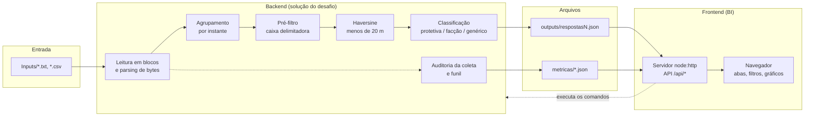

# Documentação técnica

Este documento explica **como a solução funciona e por quê**: o objetivo, as tecnologias de cada parte, as técnicas usadas e como cada uma foi verificada. Para instalar e rodar, veja o [README](../README.md).

## Sumário

1. [Objetivo e critérios de avaliação](#1-objetivo-e-critérios-de-avaliação)
2. [Visão geral](#2-visão-geral)
3. [Tecnologias por escopo](#3-tecnologias-por-escopo)
4. [Backend: a detecção](#4-backend-a-detecção)
5. [Backend: qualidade da coleta e aproveitamento](#5-backend-qualidade-da-coleta-e-aproveitamento)
6. [Backend: memória e medição](#6-backend-memória-e-medição)
7. [Como a correção é verificada](#7-como-a-correção-é-verificada)
8. [Frontend: o BI](#8-frontend-o-bi)
9. [Complexidade e números](#9-complexidade-e-números)
10. [Limitações conhecidas e evolução](#10-limitações-conhecidas-e-evolução)
11. [Glossário](#11-glossário)

---

## 1. Objetivo e critérios de avaliação

O desafio pede um algoritmo que leia posições de pessoas monitoradas e detecte **encontros**: dois indivíduos a **menos de 20 m**, calculados pela **fórmula de Haversine** com raio da Terra de **6.371.000 m**, no **mesmo timestamp exato**. Cada encontro é classificado como `protetiva`, `faccao` ou `generico`, e cada par é registrado uma vez por instante.

A avaliação tem dois critérios, e cada decisão do projeto atende a um deles:

| Critério | O que significa | Como a solução atende |
| :--- | :--- | :--- |
| **Score = corretos − incorretos** | Nenhum falso positivo, nenhum encontro perdido, tipo certo | Haversine exato em todo par candidato, pré-filtro com margem demonstrada (§4.3), regras na ordem certa (§4.5) e três formas independentes de verificar o resultado (§7) |
| **Desempate: tempo médio por dataset** | Processar ~1,1 GB e 21,5 milhões de linhas o mais rápido possível | Leitura direto dos bytes (§4.1), pré-filtro que evita o Haversine em 99,99999% dos pares (§4.3) e nenhuma alocação por linha (§6) |

**Resultado atual:** 10 de 10 nos datasets com gabarito, 108 de 108 iguais à referência nos datasets avaliados e **1,93 s por dataset em média** (13,54 s no total).

Além do desafio, o projeto tem um **BI** para analisar os resultados e uma **auditoria da coleta**, que aponta problemas nos arquivos de entrada.

---

## 2. Visão geral

**Separação de responsabilidades:**

- O **backend** é a única fonte das regras: só ele lê os arquivos de entrada, calcula distâncias e classifica.
- O **BI** nunca recalcula nada. Ele lê os arquivos que o backend grava (`outputs/`, `metricas/`) e, quando precisa de algo sob demanda (dados brutos, inclusão de um arquivo), executa os comandos do backend.
- O **contrato** (`shared/contrato.d.ts`) define o formato de tudo que passa entre os dois. São só tipos, sem código.

Assim não existe uma segunda implementação das regras que possa divergir da primeira.

---

## 3. Tecnologias por escopo

### 3.1 Linguagem e runtime

| Tecnologia | Onde | Por quê |
| :--- | :--- | :--- |
| **Node.js 18+** (testado no 22) | Backend e servidor do BI | Exigido pelo desafio (JavaScript/TypeScript). O motor V8 compila o laço de comparação para código de máquina, e a API de arquivos permite ler blocos grandes sem bloquear a medição de memória. |
| **TypeScript 5, modo estrito** | Todo o código | Tipos verificados na compilação em três projetos (backend, BI no navegador e BI no Node). Erros de formato entre as partes viram erro de compilação, não bug em produção. |
| **JavaScript ES2022** | Saída compilada | Recursos modernos (`??=`, `Array.prototype.at`, classes com campos) sem polyfills. |

### 3.2 Dependências

**Nenhuma em tempo de execução.** Só módulos nativos do Node:

| Módulo | Uso |
| :--- | :--- |
| `fs`, `fs/promises` | Leitura em blocos, escrita das respostas e métricas |
| `readline` | Versão de referência da leitura (usada nos testes de equivalência) |
| `path`, `os` | Caminhos e arquivos temporários |
| `http` | Servidor do BI |
| `child_process` (`execFile`) | O servidor do BI executa os comandos do backend |
| `perf_hooks` (`performance.now`) | Medição de tempo de alta resolução |

As únicas dependências são de desenvolvimento: `typescript` e `@types/node`. Sem bibliotecas de terceiros, não há risco de quebra ou vulnerabilidade de pacote, e a instalação é pequena.

### 3.3 Navegador (BI)

| Tecnologia | Uso |
| :--- | :--- |
| **Módulos ES** | Cada aba e cada componente é um módulo TypeScript separado, carregado direto pelo navegador no modo servidor |
| **SVG gerado à mão** | Gráficos de barras, faixas de distância e mapa, sem biblioteca de gráficos |
| **CSS com variáveis (custom properties)** | Paleta única com tema claro e escuro, que segue a preferência do sistema |
| **History API** (`replaceState`) | O recorte atual (aba e filtros) fica na URL, para salvar ou compartilhar |
| **XMLHttpRequest** | Envio de arquivo com barra de progresso (o `fetch` não informa o progresso do envio) |

### 3.4 Organização e ferramentas

- **Três projetos TypeScript**, com uma base comum (`tsconfig.base.json`): `backend/tsconfig.json` (Node, CommonJS), `frontend/tsconfig.app.json` (navegador, módulos ES, DOM) e `frontend/tsconfig.servidor.json` (Node). Cada um tem seu `dist/`.
- **Scripts npm** como interface única: `tudo`, `build`, `typecheck`, `start`, `test`, `incluir`, `remover`, `brutos`, `bi`, `bi:serve`, `clean`.
- **`.editorconfig`**, **`.nvmrc`** e o campo **`engines`** padronizam o ambiente.

---

## 4. Backend: a detecção

### 4.1 Leitura em blocos, direto dos bytes

**Problema.** A forma comum de ler um arquivo de texto linha a linha (`readline`) cria uma string para cada linha, e depois mais strings para cada campo (`substring`, `replace`, `split`). Com 21,5 milhões de linhas, isso significa dezenas de milhões de alocações, e o coletor de lixo passa a dominar o tempo.

**Técnica.** O arquivo é lido em **blocos de 16 MB** para um único buffer reaproveitado. Cada linha é interpretada **direto dos bytes** (`backend/src/deteccao/leituraBytes.ts`):

1. Encontra a quebra de linha e os `;` percorrendo os bytes.
2. Converte o id e as coordenadas acumulando dígitos num número, sem criar texto.
3. Compara o timestamp **byte a byte** com o do instante atual. Só cria uma string quando o instante muda (~100 mil vezes no dataset 7, contra 12 milhões de linhas).
4. Guarda as facções num pequeno cache, porque há poucos valores distintos.

**Caminho rápido e caminho seguro.** Só o formato comum dos dados passa pelo caminho rápido: id só com dígitos, coordenada no formato `-ddd.ddddd`, `true`/`false`, aspas só nas pontas. Qualquer linha diferente (expoente, espaços, aspas no meio, maiúsculas) é decodificada e passa pela mesma função `parseLine` da versão original. Assim a semântica é **idêntica por construção**: o caminho rápido só aceita o que ele sabe interpretar exatamente igual.

**Por que a conversão de números é exata.** O caminho rápido converte `-23.55005` como o inteiro `-2355005` dividido por `10⁵`. Com até 15 dígitos, o inteiro e a potência de 10 são representados exatamente em ponto flutuante, e a divisão IEEE 754 é corretamente arredondada. O resultado é, portanto, o mesmo double que o `parseFloat` daria para o mesmo texto. Por isso as distâncias, e os JSONs de saída, saem idênticos byte a byte.

**Ganho medido.** Comparada lado a lado, no mesmo momento, com a leitura via `readline`: de **2,2 a 3,5 vezes mais rápida**, com resultado idêntico.

### 4.2 Agrupamento por instante (processamento em fluxo)

Os arquivos chegam ordenados por tempo, com todas as leituras de um instante em sequência. O detector acumula as linhas de um instante num **lote** e, quando o timestamp muda, compara os pares desse lote e o descarta.

- **Memória constante:** só um instante fica em memória por vez (no máximo 120 pessoas nos datasets), independentemente do tamanho do arquivo.
- **Sem pré-processamento:** não é preciso ordenar nem indexar o arquivo antes.
- **Suposição verificada:** se um arquivo vier fora de ordem, a auditoria registra `fora_de_ordem` ou `instante_repetido` (§5), em vez de produzir um resultado errado em silêncio.

### 4.3 Pré-filtro por caixa delimitadora

**Problema.** Dentro de cada instante, todo par de pessoas precisa ser considerado. São **1,16 bilhão de pares** nos 7 datasets. O Haversine usa seno, cosseno, raiz e arco-tangente, e calculá-lo para todos os pares seria o gargalo.

**Técnica.** Antes do Haversine, o par é descartado se a diferença de latitude passar de **0,00025°** ou a de longitude passar de **0,00035°**. São duas subtrações e duas comparações.

**Por que nunca descarta um encontro real.** Com R = 6.371.000 m:

- **1° de latitude** = 2πR / 360 = **111.194,93 m**. A distância entre dois pontos é sempre pelo menos a distância ao longo do meridiano, R·|Δφ|. Logo, Δlat > 0,00025° significa mais de **27,80 m**, ou seja, comprovadamente acima de 20 m.
- **1° de longitude** vale 111.194,93 m × cos φ. A margem de 0,00035° equivale a 38,92 m no equador e a **32,36 m** na latitude máxima dos dados (33,75°S). Também está acima de 20 m.
- A margem de longitude continua segura enquanto 38,92 m × cos φ ≥ 20 m, isto é, até **|φ| ≈ 59°**. Isso cobre todo o território brasileiro com folga.

**Ganho.** Dos 1.163.510.590 pares, só **134** passam o pré-filtro e têm a distância calculada. Na prática, o pré-filtro evita o Haversine em todos os pares, exceto os candidatos reais.

**Detalhe de implementação.** No começo de cada instante, as coordenadas do lote são copiadas para dois arrays numéricos (`Float64Array`). O laço de pares, que roda 714 milhões de vezes no dataset 7, lê só desses arrays e faz o teste direto, sem chamar função nem acessar objetos.

### 4.4 Fórmula de Haversine

Para os pares que passam o pré-filtro:

$$a = \sin^2\left(\frac{\Delta\phi}{2}\right) + \cos\phi_1 \cos\phi_2 \sin^2\left(\frac{\Delta\lambda}{2}\right), \qquad d = R \cdot 2\,\mathrm{atan2}\left(\sqrt{a}, \sqrt{1-a}\right)$$

- Usa **R = 6.371.000 m**, como define o desafio.
- A forma com `atan2` é numericamente estável para distâncias pequenas, que é exatamente o caso aqui (metros, não milhares de quilômetros).
- O critério é **estrito**: só `d < 20` conta. Nos dados, o encontro mais distante está a 13,3 m, então não há nenhum caso na fronteira em que um arredondamento mudaria o resultado.

### 4.5 Classificação (regras de negócio)

Aplicada nesta ordem (`backend/src/deteccao/classifier.ts`), porque a primeira regra que vale decide:

1. **`protetiva`**: um dos dois tem medida protetiva e o outro está na lista de restrição dele, em qualquer direção.
2. **Vítima sem relação:** se um dos dois é vítima e o outro não é o agressor restrito (ou os dois são vítimas), o par não é registrado.
3. **`faccao`**: os dois têm a mesma facção preenchida.
4. **`generico`**: qualquer outro par de monitorados.

A regra 2 é uma **interpretação**, porque o enunciado não trata esse caso; a justificativa está no README. Ela não muda nenhum resultado: nos 7 datasets não há nenhuma vítima a menos de 20 m de alguém que não seja o seu agressor (o funil registra **0 pares ignorados** por essa regra).

### 4.6 Unicidade e formato de saída

- Cada par é comparado uma única vez por instante (laço `j > i`), e os ids saem em **ordem crescente** em `monitoradosEncontro`.
- Se o mesmo id aparecer duas vezes no mesmo instante, a repetição é descartada e registrada como falha. Sem isso, o id formaria um "encontro" consigo mesmo.
- A saída segue exatamente o formato do enunciado: `tipo`, `monitoradosEncontro`, `timestamp`, `posicoes` e `distanciaMetros`.

---

## 5. Backend: qualidade da coleta e aproveitamento

### 5.1 Auditoria

Enquanto lê, o detector faz **10 verificações** em cada linha e guarda, para cada tipo de falha, o **total e os primeiros 25 casos**, com número da linha, conteúdo e o que foi encontrado (`deteccao/auditoria.ts`):

| Verificação | Tratamento da leitura |
| :--- | :--- |
| Linha sem os 7 campos | Descartada |
| Id não numérico | Descartada |
| Coordenada fora do intervalo ou ausente | Descartada |
| Timestamp fora do formato | Usada; avisa que a ordem pode ficar errada |
| Leitura fora de ordem | Usada; avisa que o agrupamento depende da ordem |
| Instante fora de sequência | Usada; avisa que encontros entre os lotes não são detectados |
| Leitura duplicada no instante | Repetição ignorada |
| Leitura ausente (id sem posição num instante) | Contada por id |
| Restrição para id inexistente | Conferida no fim do arquivo |
| Cadastro inconsistente | Usada como está |

**Custo zero para arquivos limpos.** As verificações por linha são comparações simples. A contagem de duplicatas e de presenças usa arrays numéricos indexados pelo id, em vez de tabelas de hash. Os exemplos só são registrados quando existe falha. Nos 7 datasets oficiais não há nenhuma falha.

### 5.2 Funil de aproveitamento

O detector também conta quantos registros e pares chegam a cada etapa:

| Etapa | Total nos 7 datasets |
| :--- | ---: |
| Registros válidos | 21.530.020 |
| Pares possíveis dentro dos instantes | 1.163.510.590 |
| Pares que passaram o pré-filtro | 134 |
| Pares a menos de 20 m | 118 |
| Encontros registrados | 118 |
| **Registros úteis** (que fazem parte de um encontro) | **236** |

Esses números aparecem no BI e mostram, de forma direta, quanto do volume de dados é efetivamente relevante para a proposta.

---

## 6. Backend: memória e medição

### 6.1 Memória constante

O dataset 7 (608 MB) roda com **~67 MB de memória do processo e ~13 MB de heap**, e funciona mesmo com o heap limitado a 128 MB. Três técnicas garantem isso:

1. **Um buffer de leitura reaproveitado**, em vez de um novo a cada bloco.
2. **Reaproveitamento de objetos:** os objetos de cada pessoa do lote voltam para uma lista de livres quando o instante termina e são preenchidos de novo no instante seguinte. Não há alocação por linha.
3. **Nenhuma referência a fatias:** um problema real encontrado no projeto. Na leitura com `readline`, cada linha é uma fatia do bloco lido do disco, e guardar qualquer pedaço dela (um timestamp num conjunto, por exemplo) mantém o bloco inteiro de 1 MB vivo na memória. Um único conjunto de timestamps fez o dataset 7 chegar a ~630 MB de heap. A solução foi guardar os instantes como **chave numérica** (`20240101000515`) e **copiar** as poucas strings que precisam ser mantidas (`detach`).

### 6.2 Medição

- **Tempo:** `performance.now()` em volta da leitura e da detecção de cada arquivo, sem contar a inicialização do Node nem a gravação do JSON (essa é medida à parte).
- **Memória:** o uso de memória do processo é amostrado a cada 25 ms. A leitura é assíncrona entre um bloco e outro justamente para que esse amostrador consiga rodar durante o processamento.
- **Cuidado com a comparação:** na mesma máquina, medições em momentos diferentes chegaram a variar quase 2×. Por isso toda comparação de desempenho do projeto foi feita **lado a lado, no mesmo momento**.

---

## 7. Como a correção é verificada

Três verificações independentes, todas automatizadas em `npm test` (48 testes):

| Verificação | O que garante | Onde |
| :--- | :--- | :--- |
| **Gabarito oficial** | Datasets 1 e 2 iguais às respostas esperadas: pares, tipos e distâncias (tolerância de 1e-6) | Seção 4 dos testes |
| **Implementação de referência** | Datasets 3 a 5 iguais a uma versão de força bruta, que compara todos os pares, sem pré-filtro, e agrupa por timestamp no arquivo inteiro. Isso valida o pré-filtro e a suposição de ordem. | Seção 5 |
| **Equivalência da leitura** | A leitura em bytes dá exatamente os mesmos encontros, falhas e funil que a versão com `readline`, nos datasets 1 a 5, no arquivo de falhas e num arquivo de casos-limite (CRLF, BOM, sem quebra no fim, aspas, espaços, notação científica) | Seção 8 |

Além disso:

- **Auditoria:** `exemplos/dataset-com-falhas.txt` tem um caso de cada tipo de falha, e o teste confere cada contagem e o número da linha.
- **Unidades:** Haversine (0 m entre pontos idênticos; 111.194,93 m para 1° de latitude), segurança do pré-filtro e cada regra de classificação.
- **Datasets 6 e 7:** comparados com a referência e com a leitura anterior fora da suíte, por serem grandes. Os JSONs continuam idênticos byte a byte desde então.

---

## 8. Frontend: o BI

### 8.1 Dois modos de uso

| Modo | Como | O que tem |
| :--- | :--- | :--- |
| **Servidor** | `npm run bi:serve` | Todas as abas, dados atualizáveis, tabela de dados brutos, inclusão de arquivos |
| **Arquivo único** | `npm run bi` | Um `painel.html` com estilos, código e dados embutidos, que abre sem servidor e pode ser enviado |

O mesmo código serve aos dois modos. No modo servidor, o navegador carrega os módulos ES e busca `/api/dados`. No modo arquivo, um **empacotador próprio** (`frontend/src/servidor/empacotar.ts`, ~70 linhas) junta os módulos num script só, porque navegadores não carregam módulos ES de arquivos abertos do disco. Para isso funcionar sem dependências, o código segue três regras, que o empacotador valida antes de gerar o arquivo: imports nomeados e relativos, sem `export default`, e nomes de topo únicos entre os módulos.

### 8.2 Modelo de dados e indicadores

O navegador recebe os encontros, o cadastro de cada dataset (tirado do primeiro instante do arquivo) e as métricas. A partir disso, deriva:

- **Episódios:** leituras seguidas (a cada 5 s) do mesmo par contam como um episódio. Os 118 encontros formam 115 episódios.
- **Exposição:** encontros por 1.000 horas-pessoa monitoradas, para comparar datasets de tamanhos diferentes. Com filtro de período, conta só as horas dentro dele.
- **Taxa por membro de facção:** encontros de facção ÷ número de membros. Esse indicador mostrou que todas as facções têm a mesma taxa (0,50 por membro), e que a facção "líder" só tem mais encontros por ser maior.
- **Indicadores de vítimas:** vítimas afetadas, agressores reincidentes, menor distância e tempo até a primeira violação.

Os indicadores usados por mais de uma aba ficam num só lugar (`nucleo/indicadores.ts`), para que o Resumo e as abas de detalhe sempre mostrem o mesmo número.

### 8.3 Interface

- **Abas por assunto:** Resumo, Encontros, Vítimas, Facções, Registros, Dados brutos, Qualidade da coleta, Desempenho e Incluir dados.
- **Cartões simples:** cada um responde a uma pergunta, com o número, uma frase de explicação, a situação (Crítico, Atenção ou OK) e "Como é calculado".
- **Filtros globais:** dataset, período, tipo de encontro, tipo de pessoa e facção. Cada aba declara quais filtros usa.
- **Estado na URL:** qualquer recorte pode ser salvo ou compartilhado como link.
- **Acessibilidade:** navegação por teclado nas abas, rótulos nos controles, cor nunca como única forma de informação (sempre com rótulo ou número) e respeito à preferência por menos animação.

### 8.4 Servidor do BI

- **`node:http` puro**, ouvindo só em `127.0.0.1` (não fica acessível na rede).
- **Uma fonte de regras:** para dados brutos, inclusão e remoção, o servidor executa os comandos do backend (`backend/dist/cli/*.js`) e repassa o JSON. Ele não reimplementa nenhuma regra.
- **Segurança:**
  - as rotas que alteram dados exigem o cabeçalho `X-Radar: 1` e origem `localhost`, o que impede que outro site aberto no navegador use o servidor local;
  - caminhos de arquivo são resolvidos e conferidos para não sair da pasta pública (`/../package.json` → 404);
  - o envio de arquivo é gravado em disco aos poucos, com limite de 2 GB, e só um envio é processado por vez.

### 8.5 Tabela de dados brutos paginada

São 21,5 milhões de linhas, que não cabem numa página. O backend entrega **uma página por vez** (`cli/brutos.ts`):

1. Na primeira vez, monta um **índice de cada arquivo**, com o byte e a linha em que começa cada instante. Fica em cache em `metricas/indices/` e é refeito se o arquivo mudar.
2. Para uma página, converte o número da linha no instante que a contém, por **busca binária** no índice.
3. Lê do disco só os instantes que cobrem a página, explica cada um com as mesmas funções da detecção e devolve as linhas pedidas, com tratamento, pessoa mais próxima e resultado de cada par.

Resultado: qualquer página, entre mais de 200 mil, abre em ~0,1–0,2 s.

---

## 9. Complexidade e números

Sendo **L** o número de linhas, **T** o número de instantes e **nₜ** o número de pessoas no instante t:

| Etapa | Tempo | Memória |
| :--- | :--- | :--- |
| Leitura e parsing | O(L) | O(1): um buffer de 16 MB |
| Comparação de pares | O(Σ nₜ²); com pré-filtro, o trabalho caro (Haversine) é O(candidatos) | O(maior nₜ) |
| Auditoria | O(L) | O(ids distintos + T) |

**Números da execução de referência** (Windows 11, Node 22.2):

| Medida | Valor |
| :--- | ---: |
| Tamanho total dos arquivos | ~1,1 GB |
| Linhas de dados | 21.530.020 |
| Instantes | 203.417 |
| Maior número de pessoas num instante | 120 |
| Tempo total (7 datasets) | 13,54 s |
| Tempo médio por dataset | 1,93 s |
| Vazão | ~1,6 milhão de posições/s (~80 MB/s) |
| Memória no dataset 7 | ~67 MB (processo), ~13 MB (heap) |

---

## 10. Limitações conhecidas e evolução

- **Arquivo ordenado por tempo.** O agrupamento por instante assume que as leituras de um instante vêm em sequência. Todos os datasets cumprem isso, e a auditoria avisa se um arquivo não cumprir. Para aceitar arquivos desordenados, seria preciso agrupar por timestamp no arquivo inteiro, como faz a implementação de referência, com custo de memória.
- **Latitude.** O pré-filtro é seguro até |φ| ≈ 59° (§4.3). Para uso perto dos polos, a margem de longitude teria de crescer com 1/cos φ.
- **Comparação O(n²) por instante.** Com até 120 pessoas por instante, isso custa pouco. Com milhares de pessoas, uma grade espacial (agrupar por células de ~25 m e comparar só células vizinhas) passaria a compensar.
- **Separadores de linha.** São aceitos `\n` e `\r\n`. O `\r` sozinho (formato antigo do Mac OS) não é tratado como quebra de linha.
- **Dados sintéticos.** Algumas regularidades dos dados vêm do gerador, não de comportamento real: o número de encontros quase não cresce com o volume, e todas as facções têm a mesma taxa por membro. O BI mostra isso de forma explícita, em vez de apresentar como descoberta.

---

## 11. Glossário

| Termo | Significado |
| :--- | :--- |
| **Instante** | Um timestamp. As posições são geradas a cada 5 segundos. |
| **Lote** | As leituras de um mesmo instante, comparadas entre si. |
| **Registro** | Uma linha de dados: a posição de uma pessoa num instante. |
| **Encontro** | Um par a menos de 20 m no mesmo instante, registrado uma vez por instante. |
| **Episódio** | Encontros do mesmo par em leituras seguidas, contados como uma única aproximação. |
| **Pré-filtro** | O teste de caixa delimitadora que descarta pares comprovadamente distantes antes do Haversine. |
| **Candidato** | Par (ou registro) que passou o pré-filtro. |
| **Registro útil** | Registro que faz parte de pelo menos um encontro. |
| **Horas-pessoa** | Pessoas monitoradas × horas de monitoramento; base para comparar datasets de tamanhos diferentes. |
| **Implementação de referência** | Versão propositalmente simples (força bruta, sem pré-filtro) usada só para conferir o resultado. |
